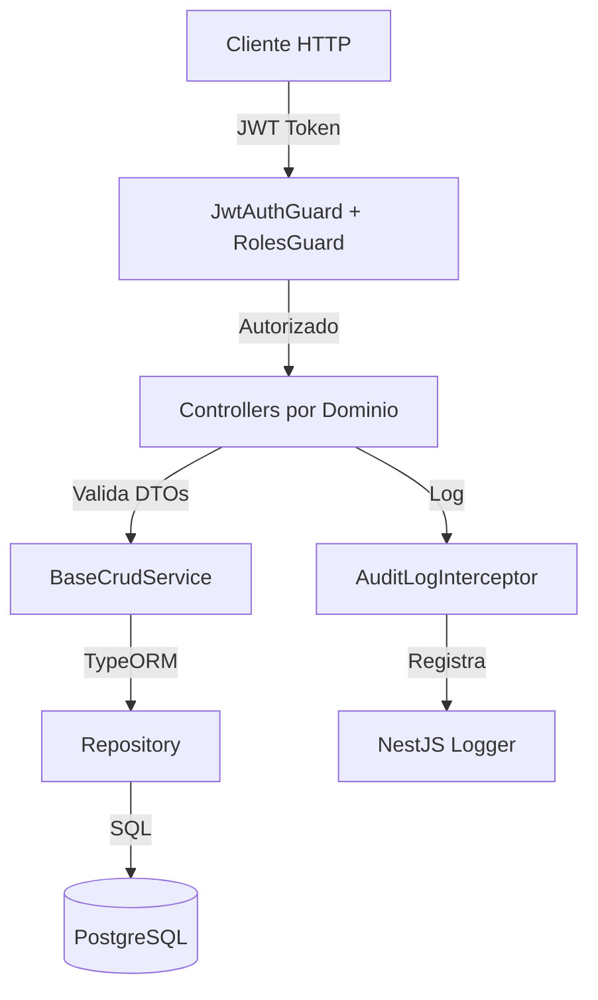

# Design Document: Super Admin CRUD Endpoints

## Overview

Este documento define el diseño técnico para implementar endpoints CRUD completos para el rol de SuperUsuario en la aplicación NestJS de gestión médica. El sistema permitirá a usuarios con privilegios administrativos máximos gestionar todas las entidades del sistema a través de una API REST bien estructurada.

### Objetivos del Diseño

- Crear un módulo dedicado `SuperAdminModule` que centralice toda la funcionalidad administrativa
- Implementar endpoints CRUD para 21 entidades del sistema organizados por dominio
- Reutilizar la infraestructura de autenticación existente (JWT + Roles Guard)
- Proporcionar operaciones CRUD genéricas y reutilizables mediante services base
- Garantizar validación robusta de datos y manejo consistente de errores
- Implementar soft delete para mantener integridad histórica
- Documentar completamente la API con Swagger
- Registrar todas las operaciones administrativas para auditoría

### Alcance

**Incluye:**
- Módulo SuperAdminModule con controllers organizados por dominio
- Services genéricos para operaciones CRUD
- DTOs de validación para cada entidad
- Integración con guards existentes (JwtAuthGuard, RolesGuard)
- Paginación, filtrado y búsqueda en listados
- Soft delete usando TypeORM DeleteDateColumn
- Logging de operaciones administrativas
- Documentación Swagger completa

**No Incluye:**
- Modificación de entidades existentes
- Implementación de lógica de negocio específica de cada entidad
- Frontend o interfaz de usuario
- Sistema de permisos granulares más allá del rol SuperUsuario


## Architecture

### Arquitectura General

El diseño sigue el patrón arquitectónico de NestJS con separación clara de responsabilidades:

```
SuperAdminModule
├── Controllers (organizados por dominio)
│   ├── UsersAdminController
│   ├── MedicalAdminController
│   ├── AppointmentsAdminController
│   └── ContentAdminController
├── Services
│   ├── BaseCrudService<T> (genérico reutilizable)
│   └── Services específicos por entidad
├── DTOs (organizados por entidad)
│   ├── users/
│   ├── medical/
│   ├── appointments/
│   └── content/
└── Interceptors
    └── AuditLogInterceptor
```

### Diagrama de Arquitectura



### Patrones de Diseño

1. **Generic Repository Pattern**: `BaseCrudService<T>` proporciona operaciones CRUD genéricas reutilizables
2. **Controller per Domain**: Controllers agrupados por dominio funcional (users, medical, appointments, content)
3. **DTO Pattern**: Validación y transformación de datos usando class-validator y class-transformer
4. **Guard Pattern**: Autenticación y autorización mediante guards reutilizables
5. **Interceptor Pattern**: Logging transversal de operaciones administrativas


## Components and Interfaces

### 1. SuperAdminModule

Módulo principal que encapsula toda la funcionalidad administrativa.

```typescript
@Module({
  imports: [
    TypeOrmModule.forFeature([
      // Entidades de usuarios
      Usuario, Persona, Estudiante, Docente, Consultor, 
      Administrativo, Rol, HistorialUsuario, ContratoConsultor,
      // Entidades médicas
      Doctor, EspecialidadMedica, PostaMedica, ConsultorioEspecialidad,
      AsignacionDoctorConsultorio, Derivacion, FechaCierre,
      // Entidades de citas
      ReservaPaciente, ReservaPacienteCancelada, ConsultaMedica, 
      Pago, ConfiguracionReservaConsulta,
      // Entidades de contenido
      ConsejoDiario
    ])
  ],
  controllers: [
    UsersAdminController,
    MedicalAdminController,
    AppointmentsAdminController,
    ContentAdminController
  ],
  providers: [
    BaseCrudService,
    AuditLogInterceptor
  ]
})
export class SuperAdminModule {}
```

### 2. BaseCrudService<T>

Service genérico que proporciona operaciones CRUD reutilizables para cualquier entidad.

```typescript
@Injectable()
export class BaseCrudService<T> {
  constructor(
    private readonly repository: Repository<T>,
    private readonly entityName: string
  ) {}

  async findAll(options: FindAllOptions): Promise<PaginatedResponse<T>>
  async findOne(id: number, relations?: string[]): Promise<T>
  async create(createDto: any): Promise<T>
  async update(id: number, updateDto: any): Promise<T>
  async softDelete(id: number): Promise<void>
  async restore(id: number): Promise<void>
}
```

**Interfaces:**

```typescript
interface FindAllOptions {
  page?: number;
  limit?: number;
  filters?: Record<string, any>;
  search?: string;
  searchFields?: string[];
  relations?: string[];
  orderBy?: string;
  orderDirection?: 'ASC' | 'DESC';
}

interface PaginatedResponse<T> {
  data: T[];
  meta: {
    total: number;
    page: number;
    limit: number;
    totalPages: number;
  };
}
```


### 3. Controllers por Dominio

#### UsersAdminController

Gestiona entidades relacionadas con usuarios del sistema.

```typescript
@ApiTags('Super Admin - Users')
@ApiBearerAuth()
@Controller('super-admin/users')
@UseGuards(JwtAuthGuard, RolesGuard)
@Roles('SuperUsuario')
@UseInterceptors(AuditLogInterceptor)
export class UsersAdminController {
  // Endpoints para: Usuario, Persona, Estudiante, Docente, 
  // Consultor, Administrativo, Rol, HistorialUsuario, ContratoConsultor
}
```

**Rutas:**
- `GET /super-admin/users/usuarios` - Listar usuarios
- `GET /super-admin/users/usuarios/:id` - Obtener usuario
- `POST /super-admin/users/usuarios` - Crear usuario
- `PUT /super-admin/users/usuarios/:id` - Actualizar usuario
- `DELETE /super-admin/users/usuarios/:id` - Eliminar usuario (soft delete)
- Similar para: personas, estudiantes, docentes, consultores, administrativos, roles, historial-usuarios, contratos-consultores

#### MedicalAdminController

Gestiona entidades relacionadas con infraestructura médica.

```typescript
@ApiTags('Super Admin - Medical')
@ApiBearerAuth()
@Controller('super-admin/medical')
@UseGuards(JwtAuthGuard, RolesGuard)
@Roles('SuperUsuario')
@UseInterceptors(AuditLogInterceptor)
export class MedicalAdminController {
  // Endpoints para: Doctor, EspecialidadMedica, PostaMedica,
  // ConsultorioEspecialidad, AsignacionDoctorConsultorio, Derivacion, FechaCierre
}
```

**Rutas:**
- `GET /super-admin/medical/doctores` - Listar doctores
- `GET /super-admin/medical/doctores/:id` - Obtener doctor
- `POST /super-admin/medical/doctores` - Crear doctor
- `PUT /super-admin/medical/doctores/:id` - Actualizar doctor
- `DELETE /super-admin/medical/doctores/:id` - Eliminar doctor (soft delete)
- Similar para: especialidades-medicas, postas-medicas, consultorios-especialidad, asignaciones-doctor-consultorio, derivaciones, fechas-cierre


#### AppointmentsAdminController

Gestiona entidades relacionadas con citas y reservas.

```typescript
@ApiTags('Super Admin - Appointments')
@ApiBearerAuth()
@Controller('super-admin/appointments')
@UseGuards(JwtAuthGuard, RolesGuard)
@Roles('SuperUsuario')
@UseInterceptors(AuditLogInterceptor)
export class AppointmentsAdminController {
  // Endpoints para: ReservaPaciente, ReservaPacienteCancelada,
  // ConsultaMedica, Pago, ConfiguracionReservaConsulta
}
```

**Rutas:**
- `GET /super-admin/appointments/reservas` - Listar reservas
- `GET /super-admin/appointments/reservas/:id` - Obtener reserva
- `POST /super-admin/appointments/reservas` - Crear reserva
- `PUT /super-admin/appointments/reservas/:id` - Actualizar reserva
- `DELETE /super-admin/appointments/reservas/:id` - Eliminar reserva (soft delete)
- Similar para: reservas-canceladas, consultas-medicas, pagos, configuraciones-reserva-consulta

#### ContentAdminController

Gestiona entidades de contenido del sistema.

```typescript
@ApiTags('Super Admin - Content')
@ApiBearerAuth()
@Controller('super-admin/content')
@UseGuards(JwtAuthGuard, RolesGuard)
@Roles('SuperUsuario')
@UseInterceptors(AuditLogInterceptor)
export class ContentAdminController {
  // Endpoints para: ConsejoDiario
}
```

**Rutas:**
- `GET /super-admin/content/consejos-diarios` - Listar consejos
- `GET /super-admin/content/consejos-diarios/:id` - Obtener consejo
- `POST /super-admin/content/consejos-diarios` - Crear consejo
- `PUT /super-admin/content/consejos-diarios/:id` - Actualizar consejo
- `DELETE /super-admin/content/consejos-diarios/:id` - Eliminar consejo (soft delete)


### 4. DTOs (Data Transfer Objects)

Los DTOs se organizan por dominio y entidad, siguiendo la estructura:

```
src/super-admin/
└── dto/
    ├── users/
    │   ├── create-usuario.dto.ts
    │   ├── update-usuario.dto.ts
    │   ├── create-persona.dto.ts
    │   ├── update-persona.dto.ts
    │   └── ... (otros DTOs de usuarios)
    ├── medical/
    │   ├── create-doctor.dto.ts
    │   ├── update-doctor.dto.ts
    │   └── ... (otros DTOs médicos)
    ├── appointments/
    │   ├── create-reserva.dto.ts
    │   ├── update-reserva.dto.ts
    │   └── ... (otros DTOs de citas)
    ├── content/
    │   ├── create-consejo-diario.dto.ts
    │   └── update-consejo-diario.dto.ts
    └── common/
        ├── pagination.dto.ts
        └── filter.dto.ts
```

**Ejemplo de DTO con validación:**

```typescript
export class CreateUsuarioDto {
  @ApiProperty({ description: 'ID de la persona asociada', example: 1 })
  @IsNumber()
  @IsNotEmpty()
  idPersona: number;

  @ApiProperty({ description: 'Nombre de usuario único', example: 'jperez' })
  @IsString()
  @IsNotEmpty()
  @Length(3, 50)
  username: string;

  @ApiProperty({ description: 'Contraseña del usuario', example: 'Pass123!' })
  @IsString()
  @IsNotEmpty()
  @MinLength(8)
  password: string;

  @ApiProperty({ description: 'Usuario bloqueado', example: false, required: false })
  @IsBoolean()
  @IsOptional()
  bloqueado?: boolean;

  @ApiProperty({ description: 'Usuario puede reservar', example: true, required: false })
  @IsBoolean()
  @IsOptional()
  is_book?: boolean;
}
```

**DTO de Paginación:**

```typescript
export class PaginationDto {
  @ApiProperty({ description: 'Número de página', example: 1, required: false })
  @IsOptional()
  @IsInt()
  @Min(1)
  @Type(() => Number)
  page?: number = 1;

  @ApiProperty({ description: 'Elementos por página', example: 10, required: false })
  @IsOptional()
  @IsInt()
  @Min(1)
  @Max(100)
  @Type(() => Number)
  limit?: number = 10;

  @ApiProperty({ description: 'Campo de ordenamiento', required: false })
  @IsOptional()
  @IsString()
  orderBy?: string;

  @ApiProperty({ description: 'Dirección de ordenamiento', enum: ['ASC', 'DESC'], required: false })
  @IsOptional()
  @IsEnum(['ASC', 'DESC'])
  orderDirection?: 'ASC' | 'DESC' = 'ASC';
}
```


### 5. AuditLogInterceptor

Interceptor para registrar todas las operaciones administrativas.

```typescript
@Injectable()
export class AuditLogInterceptor implements NestInterceptor {
  private readonly logger = new Logger('SuperAdminAudit');

  intercept(context: ExecutionContext, next: CallHandler): Observable<any> {
    const request = context.switchToHttp().getRequest();
    const { method, url, user, body, params } = request;
    
    const logData = {
      timestamp: new Date().toISOString(),
      user: user?.username || 'unknown',
      userId: user?.idUsuario,
      method,
      url,
      params,
      body: this.sanitizeBody(body)
    };

    this.logger.log(`[${method}] ${url} - User: ${logData.user}`, JSON.stringify(logData));

    return next.handle().pipe(
      tap((response) => {
        this.logger.log(`[${method}] ${url} - Success`, { ...logData, status: 'success' });
      }),
      catchError((error) => {
        this.logger.error(`[${method}] ${url} - Error`, { ...logData, error: error.message });
        throw error;
      })
    );
  }

  private sanitizeBody(body: any): any {
    if (!body) return body;
    const sanitized = { ...body };
    if (sanitized.password) sanitized.password = '***';
    return sanitized;
  }
}
```

### 6. Guards y Decoradores

Reutilización de la infraestructura existente:

```typescript
// Uso en controllers
@UseGuards(JwtAuthGuard, RolesGuard)
@Roles('SuperUsuario')
```

El sistema ya cuenta con:
- `JwtAuthGuard`: Valida tokens JWT usando passport-jwt
- `RolesGuard`: Valida roles del usuario desde el payload JWT
- `@Roles()`: Decorador para especificar roles requeridos


## Data Models

### Entidades del Sistema

El sistema gestiona 21 entidades distribuidas en 4 dominios:

#### Dominio: Users (9 entidades)

1. **Usuario** (`usuarios`)
   - Campos: idUsuario, idPersona, username, password, bloqueado, is_book, deletedAt, fechaCreacion
   - Soft delete: ✓ (DeleteDateColumn)
   - Relaciones: OneToOne con Persona, OneToMany con ReservaPaciente y Pago

2. **Persona** (`personas`)
   - Campos: idPersona, ci, nombres, primerApellido, segundoApellido, fechaNacimiento, genero, celular, email, direccion, foto, fechaRegistro, activo, deletedAt
   - Soft delete: ✓ (DeleteDateColumn)
   - Relaciones: OneToOne con Usuario, Estudiante, Docente, Administrativo, Consultor, Doctor; OneToMany con Rol, HistorialUsuario

3. **Estudiante** (`estudiantes`)
   - Campos: idEstudiante, idPersona, carrera, semestre, codigoEstudiante, deletedAt
   - Soft delete: ✓ (DeleteDateColumn)
   - Relaciones: OneToOne con Persona

4. **Docente** (`docentes`)
   - Campos: idDocente, idPersona, departamento, especialidad, deletedAt
   - Soft delete: ✓ (DeleteDateColumn)
   - Relaciones: OneToOne con Persona

5. **Consultor** (`consultores`)
   - Campos: idConsultor, idPersona, areaEspecializacion, deletedAt
   - Soft delete: ✓ (DeleteDateColumn)
   - Relaciones: OneToOne con Persona, OneToMany con ContratoConsultor

6. **Administrativo** (`administrativos`)
   - Campos: idAdministrativo, idPersona, cargo, deletedAt
   - Soft delete: ✓ (DeleteDateColumn)
   - Relaciones: OneToOne con Persona

7. **Rol** (`roles`)
   - Campos: idRol, idPersona, nombreRol, fechaAsignacion, deletedAt
   - Soft delete: ✓ (DeleteDateColumn)
   - Relaciones: ManyToOne con Persona

8. **HistorialUsuario** (`historial_usuarios`)
   - Campos: idHistorialUsuario, idPersona, accion, fechaAccion, detalles, deletedAt
   - Soft delete: ✓ (DeleteDateColumn)
   - Relaciones: ManyToOne con Persona

9. **ContratoConsultor** (`contratos_consultores`)
   - Campos: idContratoConsultor, idConsultor, fechaInicio, fechaFin, monto, estado, deletedAt
   - Soft delete: ✓ (DeleteDateColumn)
   - Relaciones: ManyToOne con Consultor


#### Dominio: Medical (7 entidades)

1. **Doctor** (`doctores`)
   - Campos: idDoctor, idPersona, idEspecialidadMedica, matriculaProfesional, experienciaProfesional, universidadOrigen, tituloProfesional, telefonoEmergencia, deletedAt
   - Soft delete: ✓ (DeleteDateColumn)
   - Relaciones: OneToOne con Persona, ManyToOne con EspecialidadMedica, OneToMany con AsignacionDoctorConsultorio, ConsultaMedica, ReservaPaciente

2. **EspecialidadMedica** (`especialidades_medicas`)
   - Campos: idEspecialidadMedica, nombreEspecialidad, descripcion, deletedAt
   - Soft delete: ✓ (DeleteDateColumn)
   - Relaciones: OneToMany con Doctor, ConsultorioEspecialidad, ReservaPaciente

3. **PostaMedica** (`postas_medicas`)
   - Campos: idPosta, nombrePosta, direccion, telefono, horarioAtencion, deletedAt
   - Soft delete: ✓ (DeleteDateColumn)
   - Relaciones: OneToMany con ConsultorioEspecialidad, ReservaPaciente

4. **ConsultorioEspecialidad** (`consultorios_especialidad`)
   - Campos: idConsultorio, idPosta, idEspecialidadMedica, numeroConsultorio, capacidad, deletedAt
   - Soft delete: ✓ (DeleteDateColumn)
   - Relaciones: ManyToOne con PostaMedica y EspecialidadMedica, OneToMany con AsignacionDoctorConsultorio

5. **AsignacionDoctorConsultorio** (`asignacion_doctores_consultorio`)
   - Campos: idAsignacionDoctoresConsultorio, idDoctor, idConsultorio, diaSemana, horaInicio, horaFin, deletedAt
   - Soft delete: ✓ (DeleteDateColumn)
   - Relaciones: ManyToOne con Doctor y ConsultorioEspecialidad

6. **Derivacion** (`derivaciones`)
   - Campos: idDerivacion, idUsuario, idEspecialidadMedica, idDoctor, motivo, estado, fechaDerivacion, fechaAtencion, observaciones, deletedAt
   - Soft delete: ✓ (DeleteDateColumn)
   - Relaciones: ManyToOne con Usuario, EspecialidadMedica, Doctor

7. **FechaCierre** (`fecha_cierre`)
   - Campos: idFechaCierre, fecha, motivo, deletedAt
   - Soft delete: ✓ (DeleteDateColumn)
   - Relaciones: Ninguna


#### Dominio: Appointments (5 entidades)

1. **ReservaPaciente** (`reservas_paciente`)
   - Campos: idReservaPaciente, idUsuario, idEspecialidad, idPosta, idDoctor, fechaCita, horaInicioCita, horaFinCita, fechaSolicitud, fechaCancelacionCita, motivoCancelacion, observaciones, estado, deletedAt
   - Soft delete: ✓ (DeleteDateColumn)
   - Relaciones: ManyToOne con Usuario, EspecialidadMedica, PostaMedica, Doctor; OneToOne con ConsultaMedica
   - Constraints: Unique(doctor, fechaCita, horaInicioCita), Unique(usuario, fechaCita, horaInicioCita)

2. **ReservaPacienteCancelada** (`reservas_paciente_canceladas`)
   - Campos: idReservaCancelada, idUsuario, idEspecialidad, idPosta, idDoctor, fechaCita, horaInicioCita, horaFinCita, fechaSolicitud, fechaCancelacion, motivoCancelacion, observaciones, deletedAt
   - Soft delete: ✓ (DeleteDateColumn)
   - Relaciones: ManyToOne con Usuario, EspecialidadMedica, PostaMedica, Doctor

3. **ConsultaMedica** (`consultas_medicas`)
   - Campos: idConsultaMedica, idReservaPaciente, idDoctor, diagnostico, tratamiento, observaciones, fechaConsulta, deletedAt
   - Soft delete: ✓ (DeleteDateColumn)
   - Relaciones: OneToOne con ReservaPaciente, ManyToOne con Doctor, OneToOne con Pago

4. **Pago** (`pagos`)
   - Campos: idPago, idConsultaMedica, idUsuarioRegistro, monto, metodoPago, fechaPago, estado, deletedAt
   - Soft delete: ✓ (DeleteDateColumn)
   - Relaciones: OneToOne con ConsultaMedica, ManyToOne con Usuario

5. **ConfiguracionReservaConsulta** (`configuracion_reservas_consultas`)
   - Campos: idConfiguracionReservasMedicas, diaSemana, horaInicio, horaFin, duracionConsulta, deletedAt
   - Soft delete: ✓ (DeleteDateColumn)
   - Relaciones: Ninguna

#### Dominio: Content (1 entidad)

1. **ConsejoDiario** (`consejo_diario`)
   - Campos: id, titulo, contenido, categoria, activo, fechaPublicacion, createdAt
   - Soft delete: ✗ (no tiene DeleteDateColumn, usar campo activo)
   - Relaciones: Ninguna

### Estrategia de Soft Delete

- **Entidades con DeleteDateColumn**: Usar `repository.softDelete(id)` y `repository.restore(id)`
- **Entidad ConsejoDiario**: Usar campo `activo` (establecer `activo = false` en lugar de soft delete)
- **Consultas por defecto**: Excluir registros eliminados usando `withDeleted: false` en TypeORM


## Correctness Properties

*Una propiedad es una característica o comportamiento que debe ser verdadero en todas las ejecuciones válidas de un sistema - esencialmente, una declaración formal sobre lo que el sistema debe hacer. Las propiedades sirven como puente entre las especificaciones legibles por humanos y las garantías de correctitud verificables por máquinas.*

### Property Reflection

Después de analizar los 60+ criterios de aceptación, he identificado las siguientes redundancias y consolidaciones:

**Redundancias identificadas:**
- Criterios 8.2 y 9.6 son idénticos (validación retorna 400)
- Criterios 8.4 y 13.4 son idénticos (validación de relaciones)
- Múltiples criterios de "existencia de endpoints" (3.1-3.9, 4.1-4.7, 5.1-5.5, 6.1) pueden consolidarse en propiedades por dominio
- Códigos de respuesta HTTP (9.1-9.5) pueden consolidarse en una propiedad de respuestas estándar

**Consolidaciones realizadas:**
- Propiedades de autenticación/autorización (1.1-1.4) → 2 propiedades + 2 ejemplos
- Propiedades de soft delete (7.1-7.4) → 2 propiedades consolidadas
- Propiedades de validación (8.1-8.4) → 3 propiedades (eliminando duplicado 8.2/9.6 y 8.4/13.4)
- Propiedades de respuestas HTTP (9.1-9.7) → 3 propiedades consolidadas
- Propiedades de paginación (11.1-11.4) → 2 propiedades consolidadas
- Propiedades de filtrado (12.1-12.4) → 2 propiedades consolidadas
- Propiedades de relaciones (13.1-13.3) → 2 propiedades (eliminando duplicado 13.4)
- Propiedades de logging (14.1-14.3) → 1 propiedad consolidada


### Property 1: Autenticación JWT requerida

*Para cualquier* endpoint CRUD del SuperUsuario, cuando se realiza una petición sin token JWT válido, el sistema debe retornar código HTTP 401 (Unauthorized).

**Validates: Requirements 1.1, 1.4**

### Property 2: Autorización de rol SuperUsuario requerida

*Para cualquier* endpoint CRUD administrativo, cuando un usuario autenticado sin rol "SuperUsuario" intenta acceder, el sistema debe retornar código HTTP 403 (Forbidden).

**Validates: Requirements 1.2, 1.3**

### Property 3: Asignación automática de rol SuperUsuario

*Para cualquier* SuperUsuario creado mediante POST /super-admin/usuarios, el sistema debe asignar automáticamente el rol "SuperUsuario" en la tabla roles.

**Validates: Requirements 2.2**

### Property 4: Soft delete con DeleteDateColumn

*Para cualquier* entidad con DeleteDateColumn, cuando se ejecuta DELETE en su endpoint, el sistema debe establecer el campo deletedAt en lugar de eliminar físicamente el registro, y las consultas GET posteriores deben excluir ese registro por defecto.

**Validates: Requirements 7.1, 7.2, 7.3**

### Property 5: Desactivación mediante campo activo

*Para cualquier* entidad con campo "activo" (como ConsejoDiario), cuando se ejecuta DELETE en su endpoint, el sistema debe establecer activo=false en lugar de usar soft delete.

**Validates: Requirements 7.4**

### Property 6: Validación de DTOs

*Para cualquier* endpoint que recibe datos (POST, PUT, PATCH), cuando se envía un DTO con datos inválidos (tipos incorrectos, longitudes excedidas, formatos inválidos), el sistema debe retornar código HTTP 400 con mensajes de error descriptivos.

**Validates: Requirements 8.1, 8.2, 8.3**

### Property 7: Validación de relaciones

*Para cualquier* operación de creación o actualización que incluye IDs de entidades relacionadas, cuando se proporciona un ID que no existe en la base de datos, el sistema debe retornar código HTTP 400 indicando que la relación es inválida.

**Validates: Requirements 8.4**


### Property 8: Respuestas HTTP estándar para operaciones exitosas

*Para cualquier* operación CRUD exitosa, el sistema debe retornar el código HTTP apropiado: 200 para GET/:id y PUT/:id, 201 para POST, 200 o 204 para DELETE/:id, junto con los datos correspondientes cuando aplique.

**Validates: Requirements 9.1, 9.3, 9.4, 9.5**

### Property 9: Respuesta 404 para recursos no encontrados

*Para cualquier* operación GET/:id o PUT/:id o DELETE/:id, cuando el ID especificado no existe en la base de datos, el sistema debe retornar código HTTP 404 (Not Found).

**Validates: Requirements 9.2**

### Property 10: Paginación con valores por defecto

*Para cualquier* endpoint GET de listado, cuando se solicita sin parámetros de paginación, el sistema debe aplicar valores por defecto (page=1, limit=10) y retornar metadata de paginación (total, page, limit, totalPages) junto con los datos.

**Validates: Requirements 11.1, 11.2, 11.3**

### Property 11: Validación de parámetros de paginación

*Para cualquier* endpoint GET de listado, cuando se proporcionan parámetros page o limit con valores no positivos o no numéricos, el sistema debe retornar código HTTP 400 indicando que los parámetros son inválidos.

**Validates: Requirements 11.4**

### Property 12: Aplicación de filtros dinámicos

*Para cualquier* endpoint GET de listado, cuando se proporcionan parámetros de filtro válidos (campos booleanos, rangos de fechas, búsqueda de texto), el sistema debe aplicar esos filtros a la consulta y retornar solo los registros que cumplan con todos los criterios especificados.

**Validates: Requirements 12.1, 12.2, 12.3, 12.4**

### Property 13: Carga de relaciones

*Para cualquier* operación GET/:id, cuando se solicita con parámetro query "relations", el sistema debe incluir las relaciones especificadas en la respuesta, y si se solicita una relación inexistente, debe retornar código HTTP 400.

**Validates: Requirements 13.1, 13.2, 13.3**

### Property 14: Logging de operaciones administrativas

*Para cualquier* operación CRUD (CREATE, UPDATE, DELETE) ejecutada por un SuperUsuario, el sistema debe registrar en logs el usuario, timestamp, entidad, operación y datos relevantes (datos creados, ID y cambios para UPDATE, ID eliminado para DELETE).

**Validates: Requirements 14.1, 14.2, 14.3**


## Error Handling

### Estrategia de Manejo de Errores

El sistema implementará un manejo de errores consistente y predecible en todos los endpoints CRUD:

#### 1. Errores de Autenticación (401 Unauthorized)

**Causas:**
- Token JWT ausente
- Token JWT expirado
- Token JWT inválido o malformado

**Respuesta:**
```json
{
  "statusCode": 401,
  "message": "Unauthorized",
  "error": "No autorizado"
}
```

**Manejo:** Los guards de NestJS (JwtAuthGuard) manejan automáticamente estos errores.

#### 2. Errores de Autorización (403 Forbidden)

**Causas:**
- Usuario autenticado sin rol "SuperUsuario"
- Intento de acceso a recursos restringidos

**Respuesta:**
```json
{
  "statusCode": 403,
  "message": "Forbidden resource",
  "error": "Acceso denegado: se requiere rol SuperUsuario"
}
```

**Manejo:** RolesGuard valida el rol y lanza ForbiddenException si no coincide.

#### 3. Errores de Validación (400 Bad Request)

**Causas:**
- Datos de entrada inválidos (tipos, formatos, longitudes)
- Parámetros de paginación inválidos
- Relaciones inexistentes
- Nombres de relaciones inválidos
- Violación de constraints únicos

**Respuesta:**
```json
{
  "statusCode": 400,
  "message": [
    "username must be longer than or equal to 3 characters",
    "email must be an email"
  ],
  "error": "Bad Request"
}
```

**Manejo:** 
- ValidationPipe de NestJS valida DTOs automáticamente
- Services validan relaciones y lanzan BadRequestException con mensajes descriptivos
- Errores de base de datos (unique constraints) se capturan y transforman en BadRequestException


#### 4. Errores de Recurso No Encontrado (404 Not Found)

**Causas:**
- ID de entidad no existe en la base de datos
- Registro eliminado con soft delete

**Respuesta:**
```json
{
  "statusCode": 404,
  "message": "Usuario con ID 999 no encontrado",
  "error": "Not Found"
}
```

**Manejo:** Services verifican existencia antes de operaciones y lanzan NotFoundException si no existe.

#### 5. Errores de Conflicto (409 Conflict)

**Causas:**
- Violación de constraints únicos (username duplicado, CI duplicado)
- Violación de constraints de unicidad compuesta (doctor + fecha + hora)

**Respuesta:**
```json
{
  "statusCode": 409,
  "message": "El username 'jperez' ya está en uso",
  "error": "Conflict"
}
```

**Manejo:** Capturar errores de base de datos con código 23505 (unique violation) y transformar en ConflictException.

#### 6. Errores Internos del Servidor (500 Internal Server Error)

**Causas:**
- Errores inesperados de base de datos
- Errores de lógica no manejados
- Problemas de conexión

**Respuesta:**
```json
{
  "statusCode": 500,
  "message": "Internal server error",
  "error": "Ha ocurrido un error inesperado"
}
```

**Manejo:** 
- Exception filters globales capturan errores no manejados
- Logging detallado del error para debugging
- Respuesta genérica al cliente (no exponer detalles internos)

### Exception Filter Global

```typescript
@Catch()
export class AllExceptionsFilter implements ExceptionFilter {
  private readonly logger = new Logger(AllExceptionsFilter.name);

  catch(exception: unknown, host: ArgumentsHost) {
    const ctx = host.switchToHttp();
    const response = ctx.getResponse();
    const request = ctx.getRequest();

    let status = HttpStatus.INTERNAL_SERVER_ERROR;
    let message = 'Internal server error';

    if (exception instanceof HttpException) {
      status = exception.getStatus();
      message = exception.message;
    } else if (exception instanceof QueryFailedError) {
      // Manejar errores de base de datos
      status = HttpStatus.BAD_REQUEST;
      message = this.handleDatabaseError(exception);
    }

    this.logger.error(
      `${request.method} ${request.url}`,
      exception instanceof Error ? exception.stack : exception
    );

    response.status(status).json({
      statusCode: status,
      message,
      error: HttpStatus[status],
      timestamp: new Date().toISOString(),
      path: request.url
    });
  }
}
```


## Testing Strategy

### Enfoque Dual de Testing

El sistema implementará una estrategia de testing dual que combina:

1. **Unit Tests**: Para casos específicos, ejemplos concretos y edge cases
2. **Property-Based Tests**: Para propiedades universales que deben cumplirse con cualquier entrada válida

Ambos tipos de tests son complementarios y necesarios para cobertura completa:
- Los unit tests capturan bugs concretos y validan comportamientos específicos
- Los property tests verifican correctitud general mediante randomización de inputs

### Librería de Property-Based Testing

**Librería seleccionada:** `fast-check` (para TypeScript/JavaScript)

**Justificación:**
- Integración nativa con Jest (framework de testing de NestJS)
- Soporte completo para TypeScript
- Generadores arbitrarios flexibles para entidades complejas
- Configuración de iteraciones personalizable
- Shrinking automático para encontrar casos mínimos de fallo

**Instalación:**
```bash
npm install --save-dev fast-check
```

### Configuración de Property Tests

Cada property test debe:
- Ejecutar mínimo 100 iteraciones (configurado con `fc.assert(..., { numRuns: 100 })`)
- Incluir tag de comentario referenciando la propiedad del diseño
- Usar generadores arbitrarios apropiados para cada tipo de dato

**Formato de tag:**
```typescript
// Feature: super-admin-crud-endpoints, Property 1: Autenticación JWT requerida
```


### Unit Tests

Los unit tests se enfocarán en:

#### 1. Casos Específicos de Endpoints

**Ejemplos:**
- Verificar que POST /super-admin/users/usuarios crea un usuario correctamente
- Verificar que GET /super-admin/medical/doctores retorna lista de doctores
- Verificar que DELETE /super-admin/content/consejos-diarios/:id desactiva un consejo

**Estructura:**
```typescript
describe('UsersAdminController', () => {
  describe('POST /super-admin/users/usuarios', () => {
    it('should create a new usuario with valid data', async () => {
      const createDto = {
        idPersona: 1,
        username: 'testuser',
        password: 'Test123!',
        is_book: true
      };
      
      const result = await controller.createUsuario(createDto);
      
      expect(result).toBeDefined();
      expect(result.username).toBe('testuser');
      expect(result.idUsuario).toBeDefined();
    });
  });
});
```

#### 2. Edge Cases

**Ejemplos:**
- Intentar crear usuario con username vacío
- Intentar actualizar entidad con ID negativo
- Solicitar página 0 en paginación
- Filtrar por fecha con formato inválido

#### 3. Integración entre Componentes

**Ejemplos:**
- Verificar que guards se aplican correctamente a controllers
- Verificar que interceptor de audit log registra operaciones
- Verificar que ValidationPipe rechaza DTOs inválidos

#### 4. Manejo de Errores Específicos

**Ejemplos:**
- Verificar respuesta 401 sin token JWT
- Verificar respuesta 403 con rol incorrecto
- Verificar respuesta 404 con ID inexistente
- Verificar respuesta 409 con username duplicado


### Property-Based Tests

Los property tests verificarán las 14 propiedades de correctitud identificadas:

#### Property Test 1: Autenticación JWT requerida

```typescript
// Feature: super-admin-crud-endpoints, Property 1: Autenticación JWT requerida
describe('Property: JWT Authentication Required', () => {
  it('should return 401 for any endpoint without valid JWT token', () => {
    fc.assert(
      fc.asyncProperty(
        fc.constantFrom(
          '/super-admin/users/usuarios',
          '/super-admin/medical/doctores',
          '/super-admin/appointments/reservas',
          '/super-admin/content/consejos-diarios'
        ),
        fc.constantFrom('GET', 'POST', 'PUT', 'DELETE'),
        async (endpoint, method) => {
          const response = await request(app.getHttpServer())
            [method.toLowerCase()](endpoint)
            .send({});
          
          expect(response.status).toBe(401);
        }
      ),
      { numRuns: 100 }
    );
  });
});
```

#### Property Test 2: Autorización de rol SuperUsuario

```typescript
// Feature: super-admin-crud-endpoints, Property 2: Autorización de rol SuperUsuario requerida
describe('Property: SuperUsuario Role Authorization', () => {
  it('should return 403 for authenticated users without SuperUsuario role', () => {
    fc.assert(
      fc.asyncProperty(
        fc.constantFrom('ESTUDIANTE', 'DOCENTE', 'DOCTOR', 'ADMINISTRATIVO'),
        fc.constantFrom(
          '/super-admin/users/usuarios',
          '/super-admin/medical/doctores'
        ),
        async (role, endpoint) => {
          const token = generateTokenWithRole(role);
          const response = await request(app.getHttpServer())
            .get(endpoint)
            .set('Authorization', `Bearer ${token}`);
          
          expect(response.status).toBe(403);
        }
      ),
      { numRuns: 100 }
    );
  });
});
```

#### Property Test 3: Asignación automática de rol

```typescript
// Feature: super-admin-crud-endpoints, Property 3: Asignación automática de rol SuperUsuario
describe('Property: Automatic SuperUsuario Role Assignment', () => {
  it('should assign SuperUsuario role to any created super admin user', () => {
    fc.assert(
      fc.asyncProperty(
        fc.record({
          username: fc.string({ minLength: 3, maxLength: 50 }),
          password: fc.string({ minLength: 8 }),
          idPersona: fc.integer({ min: 1, max: 1000 })
        }),
        async (userData) => {
          const response = await authenticatedRequest('POST', '/super-admin/users/usuarios')
            .send(userData);
          
          if (response.status === 201) {
            const roles = await rolesRepository.find({ 
              where: { persona: { idPersona: userData.idPersona } } 
            });
            const hasSuperUsuarioRole = roles.some(r => r.nombreRol === 'SuperUsuario');
            expect(hasSuperUsuarioRole).toBe(true);
          }
        }
      ),
      { numRuns: 100 }
    );
  });
});
```


#### Property Test 4: Soft delete con DeleteDateColumn

```typescript
// Feature: super-admin-crud-endpoints, Property 4: Soft delete con DeleteDateColumn
describe('Property: Soft Delete with DeleteDateColumn', () => {
  it('should set deletedAt instead of physical deletion and exclude from GET queries', () => {
    fc.assert(
      fc.asyncProperty(
        fc.constantFrom(
          { entity: 'usuarios', endpoint: '/super-admin/users/usuarios' },
          { entity: 'doctores', endpoint: '/super-admin/medical/doctores' },
          { entity: 'reservas', endpoint: '/super-admin/appointments/reservas' }
        ),
        async ({ entity, endpoint }) => {
          // Crear entidad
          const created = await createRandomEntity(entity);
          
          // Eliminar con soft delete
          await authenticatedRequest('DELETE', `${endpoint}/${created.id}`);
          
          // Verificar que deletedAt está establecido
          const record = await getRepository(entity).findOne({
            where: { id: created.id },
            withDeleted: true
          });
          expect(record.deletedAt).toBeDefined();
          
          // Verificar que no aparece en GET
          const listResponse = await authenticatedRequest('GET', endpoint);
          const foundInList = listResponse.body.data.some(item => item.id === created.id);
          expect(foundInList).toBe(false);
        }
      ),
      { numRuns: 100 }
    );
  });
});
```

#### Property Test 5: Desactivación mediante campo activo

```typescript
// Feature: super-admin-crud-endpoints, Property 5: Desactivación mediante campo activo
describe('Property: Deactivation via activo field', () => {
  it('should set activo=false for entities without DeleteDateColumn', () => {
    fc.assert(
      fc.asyncProperty(
        fc.record({
          titulo: fc.string({ minLength: 5, maxLength: 100 }),
          contenido: fc.string({ minLength: 10, maxLength: 500 }),
          categoria: fc.constantFrom('salud', 'nutricion', 'ejercicio')
        }),
        async (consejoData) => {
          // Crear consejo
          const created = await authenticatedRequest('POST', '/super-admin/content/consejos-diarios')
            .send(consejoData);
          
          // Eliminar (desactivar)
          await authenticatedRequest('DELETE', `/super-admin/content/consejos-diarios/${created.body.id}`);
          
          // Verificar que activo=false
          const consejo = await consejoDiarioRepository.findOne({ 
            where: { id: created.body.id } 
          });
          expect(consejo.activo).toBe(false);
          expect(consejo.deletedAt).toBeUndefined();
        }
      ),
      { numRuns: 100 }
    );
  });
});
```

#### Property Test 6: Validación de DTOs

```typescript
// Feature: super-admin-crud-endpoints, Property 6: Validación de DTOs
describe('Property: DTO Validation', () => {
  it('should return 400 for any invalid DTO data', () => {
    fc.assert(
      fc.asyncProperty(
        fc.record({
          username: fc.oneof(fc.constant(''), fc.string({ maxLength: 2 })), // Inválido: muy corto
          password: fc.string({ maxLength: 5 }), // Inválido: muy corto
          idPersona: fc.oneof(fc.constant(-1), fc.constant(0)) // Inválido: no positivo
        }),
        async (invalidData) => {
          const response = await authenticatedRequest('POST', '/super-admin/users/usuarios')
            .send(invalidData);
          
          expect(response.status).toBe(400);
          expect(response.body.message).toBeDefined();
          expect(Array.isArray(response.body.message)).toBe(true);
        }
      ),
      { numRuns: 100 }
    );
  });
});
```


#### Property Test 7: Validación de relaciones

```typescript
// Feature: super-admin-crud-endpoints, Property 7: Validación de relaciones
describe('Property: Relationship Validation', () => {
  it('should return 400 when creating entities with non-existent related IDs', () => {
    fc.assert(
      fc.asyncProperty(
        fc.integer({ min: 999999, max: 9999999 }), // ID que no existe
        async (nonExistentId) => {
          const response = await authenticatedRequest('POST', '/super-admin/users/usuarios')
            .send({
              username: 'testuser',
              password: 'Test123!',
              idPersona: nonExistentId // Persona inexistente
            });
          
          expect(response.status).toBe(400);
          expect(response.body.message).toContain('Persona');
        }
      ),
      { numRuns: 100 }
    );
  });
});
```

#### Property Test 8: Respuestas HTTP estándar

```typescript
// Feature: super-admin-crud-endpoints, Property 8: Respuestas HTTP estándar para operaciones exitosas
describe('Property: Standard HTTP Responses', () => {
  it('should return appropriate status codes for successful CRUD operations', () => {
    fc.assert(
      fc.asyncProperty(
        fc.constantFrom(
          { method: 'POST', expectedStatus: 201 },
          { method: 'GET', expectedStatus: 200 },
          { method: 'PUT', expectedStatus: 200 }
        ),
        async ({ method, expectedStatus }) => {
          let response;
          const endpoint = '/super-admin/users/usuarios';
          
          if (method === 'POST') {
            response = await authenticatedRequest('POST', endpoint)
              .send(generateValidUsuarioData());
          } else if (method === 'GET') {
            const created = await createRandomUsuario();
            response = await authenticatedRequest('GET', `${endpoint}/${created.id}`);
          } else if (method === 'PUT') {
            const created = await createRandomUsuario();
            response = await authenticatedRequest('PUT', `${endpoint}/${created.id}`)
              .send({ username: 'updated' });
          }
          
          expect(response.status).toBe(expectedStatus);
          if (expectedStatus !== 204) {
            expect(response.body).toBeDefined();
          }
        }
      ),
      { numRuns: 100 }
    );
  });
});
```

#### Property Test 9: Respuesta 404 para recursos no encontrados

```typescript
// Feature: super-admin-crud-endpoints, Property 9: Respuesta 404 para recursos no encontrados
describe('Property: 404 for Non-Existent Resources', () => {
  it('should return 404 for any GET/PUT/DELETE operation on non-existent ID', () => {
    fc.assert(
      fc.asyncProperty(
        fc.integer({ min: 999999, max: 9999999 }),
        fc.constantFrom('GET', 'PUT', 'DELETE'),
        fc.constantFrom(
          '/super-admin/users/usuarios',
          '/super-admin/medical/doctores',
          '/super-admin/appointments/reservas'
        ),
        async (nonExistentId, method, endpoint) => {
          const response = await authenticatedRequest(method, `${endpoint}/${nonExistentId}`)
            .send({});
          
          expect(response.status).toBe(404);
        }
      ),
      { numRuns: 100 }
    );
  });
});
```


#### Property Test 10: Paginación con valores por defecto

```typescript
// Feature: super-admin-crud-endpoints, Property 10: Paginación con valores por defecto
describe('Property: Pagination with Default Values', () => {
  it('should apply default pagination and return metadata for any listing endpoint', () => {
    fc.assert(
      fc.asyncProperty(
        fc.constantFrom(
          '/super-admin/users/usuarios',
          '/super-admin/medical/doctores',
          '/super-admin/appointments/reservas',
          '/super-admin/content/consejos-diarios'
        ),
        async (endpoint) => {
          const response = await authenticatedRequest('GET', endpoint);
          
          expect(response.status).toBe(200);
          expect(response.body.data).toBeDefined();
          expect(Array.isArray(response.body.data)).toBe(true);
          expect(response.body.meta).toBeDefined();
          expect(response.body.meta.page).toBe(1);
          expect(response.body.meta.limit).toBe(10);
          expect(response.body.meta.total).toBeDefined();
          expect(response.body.meta.totalPages).toBeDefined();
        }
      ),
      { numRuns: 100 }
    );
  });
});
```

#### Property Test 11: Validación de parámetros de paginación

```typescript
// Feature: super-admin-crud-endpoints, Property 11: Validación de parámetros de paginación
describe('Property: Pagination Parameter Validation', () => {
  it('should return 400 for invalid pagination parameters', () => {
    fc.assert(
      fc.asyncProperty(
        fc.oneof(
          fc.constant(0),
          fc.constant(-1),
          fc.constant(-100)
        ),
        fc.constantFrom('/super-admin/users/usuarios', '/super-admin/medical/doctores'),
        async (invalidValue, endpoint) => {
          const response = await authenticatedRequest('GET', endpoint)
            .query({ page: invalidValue });
          
          expect(response.status).toBe(400);
        }
      ),
      { numRuns: 100 }
    );
  });
});
```

#### Property Test 12: Aplicación de filtros dinámicos

```typescript
// Feature: super-admin-crud-endpoints, Property 12: Aplicación de filtros dinámicos
describe('Property: Dynamic Filter Application', () => {
  it('should apply filters and return only matching records', () => {
    fc.assert(
      fc.asyncProperty(
        fc.boolean(),
        async (activoValue) => {
          // Crear registros con diferentes valores de activo
          await createRandomPersona({ activo: true });
          await createRandomPersona({ activo: false });
          
          const response = await authenticatedRequest('GET', '/super-admin/users/personas')
            .query({ activo: activoValue });
          
          expect(response.status).toBe(200);
          expect(response.body.data.every(p => p.activo === activoValue)).toBe(true);
        }
      ),
      { numRuns: 100 }
    );
  });
});
```


#### Property Test 13: Carga de relaciones

```typescript
// Feature: super-admin-crud-endpoints, Property 13: Carga de relaciones
describe('Property: Relationship Loading', () => {
  it('should include requested relations and reject invalid relation names', () => {
    fc.assert(
      fc.asyncProperty(
        fc.constantFrom('persona', 'reservas', 'pagosRegistrados'), // Relaciones válidas de Usuario
        async (validRelation) => {
          const usuario = await createRandomUsuario();
          
          // Probar relación válida
          const validResponse = await authenticatedRequest('GET', `/super-admin/users/usuarios/${usuario.id}`)
            .query({ relations: validRelation });
          
          expect(validResponse.status).toBe(200);
          expect(validResponse.body[validRelation]).toBeDefined();
          
          // Probar relación inválida
          const invalidResponse = await authenticatedRequest('GET', `/super-admin/users/usuarios/${usuario.id}`)
            .query({ relations: 'relacionInexistente' });
          
          expect(invalidResponse.status).toBe(400);
        }
      ),
      { numRuns: 100 }
    );
  });
});
```

#### Property Test 14: Logging de operaciones administrativas

```typescript
// Feature: super-admin-crud-endpoints, Property 14: Logging de operaciones administrativas
describe('Property: Administrative Operations Logging', () => {
  it('should log all CRUD operations with user, timestamp, entity, and operation details', () => {
    fc.assert(
      fc.asyncProperty(
        fc.constantFrom('CREATE', 'UPDATE', 'DELETE'),
        fc.constantFrom(
          { endpoint: '/super-admin/users/usuarios', entity: 'Usuario' },
          { endpoint: '/super-admin/medical/doctores', entity: 'Doctor' }
        ),
        async (operation, { endpoint, entity }) => {
          const logSpy = jest.spyOn(Logger.prototype, 'log');
          
          if (operation === 'CREATE') {
            await authenticatedRequest('POST', endpoint).send(generateValidData(entity));
          } else if (operation === 'UPDATE') {
            const created = await createRandomEntity(entity);
            await authenticatedRequest('PUT', `${endpoint}/${created.id}`).send({ updated: true });
          } else if (operation === 'DELETE') {
            const created = await createRandomEntity(entity);
            await authenticatedRequest('DELETE', `${endpoint}/${created.id}`);
          }
          
          expect(logSpy).toHaveBeenCalled();
          const logCall = logSpy.mock.calls.find(call => 
            call[0].includes(operation) && call[0].includes(endpoint)
          );
          expect(logCall).toBeDefined();
          
          logSpy.mockRestore();
        }
      ),
      { numRuns: 100 }
    );
  });
});
```

### Cobertura de Testing

**Objetivo de cobertura:**
- Cobertura de líneas: > 80%
- Cobertura de branches: > 75%
- Cobertura de funciones: > 85%

**Áreas críticas con cobertura 100%:**
- Guards (JwtAuthGuard, RolesGuard)
- BaseCrudService
- AuditLogInterceptor
- Exception filters
- Validación de DTOs

### Ejecución de Tests

```bash
# Ejecutar todos los tests
npm test

# Ejecutar solo unit tests
npm test -- --testPathPattern=unit

# Ejecutar solo property tests
npm test -- --testPathPattern=property

# Ejecutar con cobertura
npm test -- --coverage

# Ejecutar tests de un módulo específico
npm test -- super-admin
```

